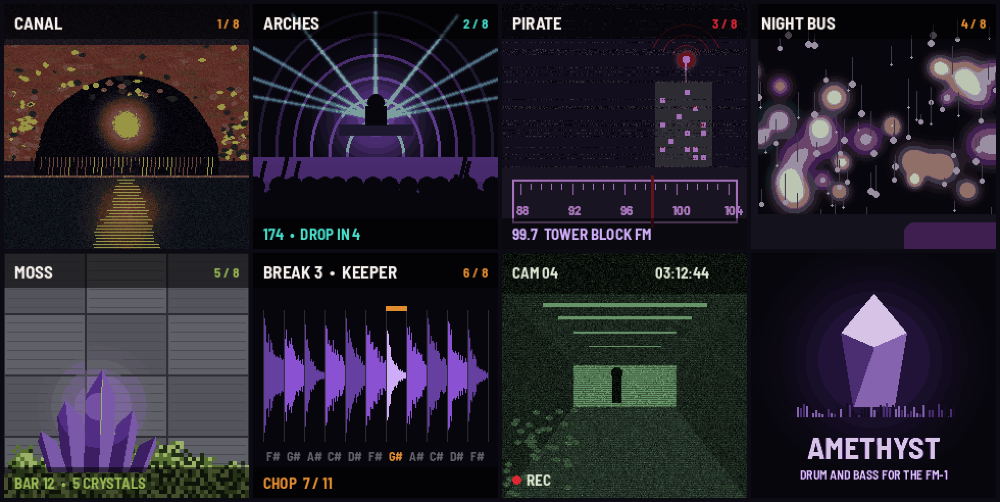
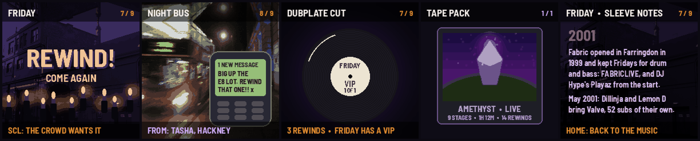
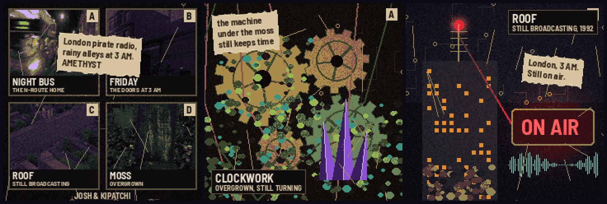
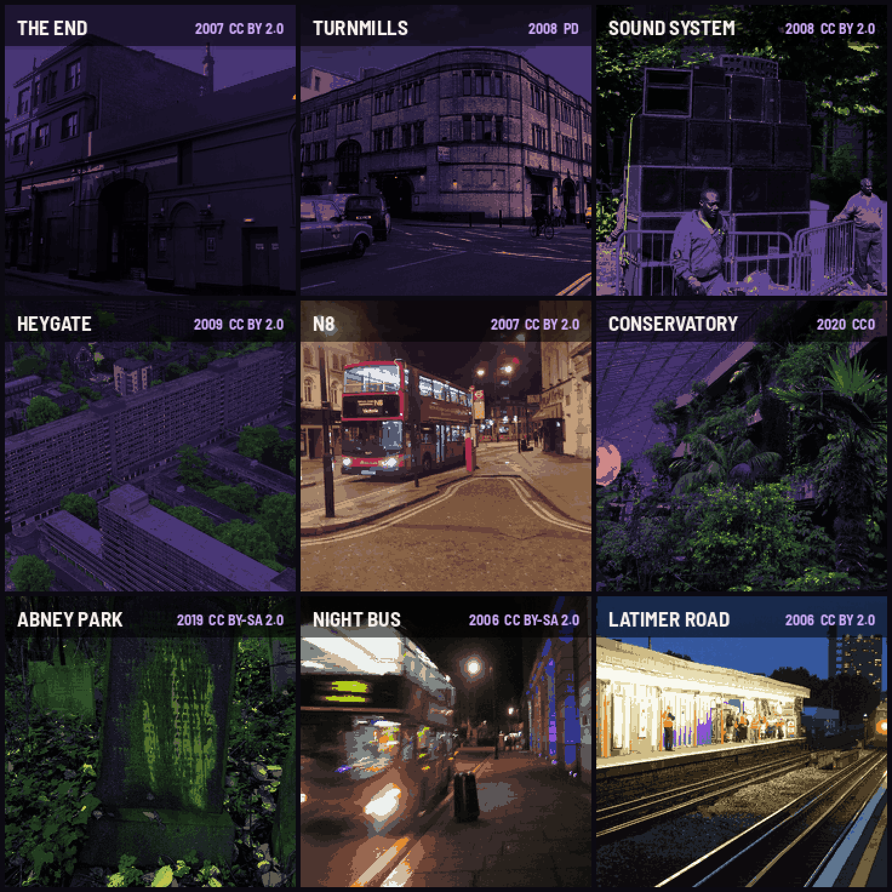

# Amethyst: drum and bass for the FM-1

Amethyst is a working name for a new FM-1 firmware Josh is making with kipatchi, whose concept and look it is. It plays drum and bass, and it is set
in a London a few years from now: wet streets, sodium lamps, tower blocks, and moss growing over all the concrete. A
break is always running. You play the bass and the chords over it, chop the break on the black keys, and hold a button
to build up to the drop.

Nothing here is built yet. This is the plan to talk over before any code. The questions at the end need answers from
Josh and kipatchi first.

The screens above are sketches at the FM-1's size, each cut to 16 colors the way Album 01 cuts its photos. They come
from `tools/amethyst/mockups.py`, so they can be redrawn as the ideas change.

---

## 1. A minute with it

You switch it on and the stone glows. The first stage is FRIDAY, 2001: a club's doors on a December night, the street
violet and wet. The break is already rolling at 174.

You hold a low white key and a Reese bass growls under the break. Every white key fits, because they're all in A minor,
so nothing can go wrong. You tap the black keys and the break stutters: each one plays a slice of it, the way jungle
producers chopped breaks on an Akai sampler in 1994.

You hold FX. A snare roll climbs and the picture whites out. Let go, and on the next bar the kick and bass drop back in.
Lighters go up on the screen and SCL starts to flash: the crowd wants a rewind. Press it, the record spins back, and
the drop comes round again. That's the whole game, and it's enough to lose an evening to.

Where all this comes from, and who made it, is in [amethyst/CULTURE.md](amethyst/CULTURE.md). Read that first.

## 2. Where to build it

On [Melodee](https://github.com/keremimo/melodee), by Kerem Kilic (Ellic Studio). Josh likes the depth of its engines,
and between them they make every sound on this plan. Melodee is a modified version of Felucca by Leo
Kuroshita, Hügelton Instruments, and it's GPL-3.0, so Amethyst would be too.

Here's what Amethyst would take from it, engine by engine. Section 10 says who wrote each part.

| Melodee part | What it does for drum and bass |
| --- | --- |
| PROPHET | Two oscillators with hard sync, Poly-Mod and a four-pole filter (SSI or Curtis): the hoover, a driven Reese, the pads and the stabs. Eight voices a track with both cores running |
| CZ-1 | Casio's phase distortion, with eight-step envelopes on each line. Kevin Saunderson made the first Reese bass on a Casio CZ in 1988, so this is where Amethyst's Reese lives. Its resonant windows make the growls for UNDERPASS |
| SID | A 6581 or 8580 at the register level. The rough edge for PIRATE, and ring mod for the siren |
| DRUM | 808, 909, CR-78, SID and FM kits. A 909 kick layered under the break, to give it a punch the old recordings don't have |
| SLOOP punch FX | 27 master effects on held keys: REWIND, STOP, HALF, LOOP 1/16, KILL LOW, FADE OUT, CRUSH, ECHO. Most of Amethyst's buttons are already in here |
| Both cores | Melodee renders voices on the FM-1's second core, which is what gives PROPHET its eight voices |

Amethyst would sit on top of Melodee the way Rainbow mode sits on Felucca: one file of its own (`amethyst.c`, like
`kid.c`) and a few small hooks, so Melodee's updates can still be merged in. A grown-up's button combination could open
the full Melodee underneath, as HOME and SAVE held do in Rainbow mode.

Two things Melodee doesn't have. It took out its SAMPLE and SLICE engines in 0.11, so a break player has to come back:
Felucca's SLICE (Leo Kuroshita's) is the place to start, cut down to one job. And there's very little room left.
Melodee 1.6.1's own build log says image 532,136 B of a 581,564 B slot (49 KB free), and RAM .data+.bss 97,016 B of
98,304 (1.3 KB free). Section 7 is about where the room comes from.

The other way would be [fm1-base](https://github.com/charlesvestal/fm1-base) by Charles Vestal, as Album 01 is built:
lean (its template is 77 KB), with Album's photo code ready. But PROPHET and CZ-1 lean on Melodee's voice allocator,
its second-core worker and its audio arena. Porting them out would be a second project, and every Melodee fix after
that would have to be carried over by hand.

Before forking, I'd write to Kerem. Melodee releases often, and it's his work; he may have ideas, or reasons, we
don't know about.

## 3. How it plays

Two rules make it easy. The break never stops unless you stop it, and the keys can't play a wrong note.

| Control | What it does |
| --- | --- |
| White keys F3 to E4 (7) | The bass. A minor, so every key fits. Hold one and press another and it slides |
| White keys F4 to G5 (9) | Chords: a minor ninth, a major seventh and so on, one a key, in the stage's own voicing |
| Black keys (11) | Slices of the break, one each, in order. Tap a few and you're chopping |
| PRESETS | The stage: its picture, its break, its bass, its chords and its tempo |
| SELECT | The tempo, 140 to 180. The break is pitched with it, as producers did on an Akai, not stretched |
| ALGORITHM | The break's pattern: AS PLAYED, CHOPPED, HALF TIME, ROLLER, TWO-STEP |
| KNOB 1 WOBBLE | The bass filter moves, slow to fast. The picture breathes with it |
| KNOB 2 FOG | Reverb and delay. Fog rolls over the picture |
| KNOB 3 GRIT | Crushed and driven, down to an S950's 12 bits and its rough time-stretch. The picture goes grainy |
| KNOB 4 MOSS | Darker and softer, rain and crackle under it. The picture goes green |
| FX (hold) | BUILD: the break loops at 1/8, then 1/16, then 1/32 (SLOOP's LOOP), with the bass killed (KILL LOW) and a high-pass rising. Let go and it drops on the next bar |
| SCL | REWIND (SLOOP's): the record spun back by hand, then the drop again. Flashes when the crowd is calling for one |
| ENV | HALF (SLOOP's), on and off |
| LFO | STOP (SLOOP's tape stop) |
| EDIT | Drums off and on (the bass carries on) |
| GLO | A dub siren on SID, played on the keys while held |
| ARP | How the keys play: BASS AND CHORDS, ALL BASS, ALL CHORDS |
| SEQ | The break on or off |
| REC | Records four bars of what you play, then loops it. Again to add a layer. Held: the TAPE PACK (below) |
| PLAY | Start and stop |
| SAVE | Keeps the stage's knobs and your loop |
| HOME | The stage back where it started. Held: its sleeve notes |
| OCT- / OCT+ | The bass an octave down or up |
| MASTER | Volume |

FX for the build is the one I'd test first with real people. If the drop doesn't feel good, the rest won't save it.

### The night's rituals

These come straight from the scene (CULTURE.md has the history of each). They're what turn a groovebox into a night
out.

1. The rewind. After a drop that landed (BUILD held for at least a bar, let go on the one), the crowd calls for it:
   lighters on the screen, SCL flashing, and the call in plain letters: REWIND, COME AGAIN, PULL UP. Answer it and the
   record spins back. Leave it and the call fades after eight bars. A rewind has to be earned, as at a dance.
2. The dubplate. Rewind a stage three times and its VIP is cut for you: a dubplate on the screen with a handwritten
   label, and from then on that stage has a second version (another bassline, the break flipped). VIP is what the
   scene called it: a variation in production, a version only one DJ had. Kept in the settings, like Rainbow mode's
   stars.
3. The shout-outs. Now and then a text arrives on a little phone at the corner of the screen, the way listeners texted
   the pirates: "big up the E8 lot," "rewind that." Made-up names, real postcodes.
4. The tape pack. REC held records the whole session to the computer over USB (Melodee already records its stereo
   output there), and the screen shows the session as a tape pack: the stages played, the time, the number of rewinds,
   on an airbrushed cover of our own.
5. The sleeve notes. HOME held shows three lines about the stage's year and place, and who made it happen. The scene
   gets credited inside the firmware, not only on the website.
6. The MC. The calls are text to start with. If an MC will record a few (REWIND, COME AGAIN, FROM THE TOP) with their
   name on them, they'd take about 11 KB a second each and be worth every byte.

## 4. The stages

Ten, in order: a night out through the years, from a rave under the arches in 1989 to a London overgrown with moss
ten years from now. Each one is a year and a place, with the break, bass and tempo of its time. The names are ours;
the real places and people are in the sleeve notes.

| # | Stage | Year | After | The picture | Break | Bass | Chords | Tempo |
| --- | --- | --- | --- | --- | --- | --- | --- | --- |
| 1 | ARCHES | 1989 | Rage at Heaven, under Charing Cross | Drawn: an arch, lasers, the crowd | Hardcore: a busy break, an 808 kick | PROPHET hoover | FM6 rave piano | 145 |
| 2 | ROOF | 1992 | Kool FM on the Nightingale Estate | The Heygate at night, a red light on the aerial | Ragga jungle | SID sub, a dub siren | none, just the siren | 160 |
| 3 | DARKSIDE | 1994 | "Terrorist," and the Reese | Turnmills at night | Chopped hard | CZ-1 Reese, as Kevin Saunderson made his | a low pad | 165 |
| 4 | SUNDAY | 1995 | The Metalheadz Sunday Sessions in Hoxton | Drawn: a blue room, smoke | Rolling, chopped | CZ-1 Reese, slow | PROPHET strings | 166 |
| 5 | VELVET | 1996 | Speed and Swerve; liquid, later | The Barbican Conservatory | Soft and swung | PROPHET round sub | FM6 electric piano | 172 |
| 6 | CLOCKWORK | 1997 | Amon Tobin's *Bricolage* on Ninja Tune; kipatchi's overgrown steampunk | Drawn: gears under moss, amethyst growing out | Jazz breaks, chopped fine, with recorded sounds for drums | PROPHET round sub | FM6 vibraphone | 168 |
| 7 | UNDERPASS | 1997 | Techstep at No U-Turn, then neurofunk | Drawn: CCTV on a tiled tunnel | Cold two-step | CZ-1 growl | SID stabs | 174 |
| 8 | FRIDAY | 2001 | FABRICLIVE, Playaz, Valve's 52 subs, The End | The End, December 2007 | A roller, a 909 kick under it | PROPHET Reese, driven | PROPHET hoover | 174 |
| 9 | NIGHT BUS | 2007 | Burial's *Untrue* | A night bus, 2006 | Half time, rain and crackle | PROPHET sub | FM6 glass | 172 |
| 10 | MOSS | 2036 | Ours: the London Amethyst imagines | Abney Park, and crystals growing | All of the above, softened | CZ-1 warm sub | CZ-1 bells | 170 |

The pictures are the Commons photos from section 6 where one fits, drawn where none does. Going forward through the
stages is going forward in time, so a jam can be a history lesson nobody notices they're getting.

Every sound here would be a new program of our own. Melodee ships Sequential's 200 Prophet-5 programs and Casio's 64
CZ-1 tones, but its own LICENSING.md says the rights to both stay with their makers. Amethyst would leave them out,
which also frees some flash.

## 5. The breaks, and what we can ship

The famous breaks can't go in. The Amen is from "Amen, Brother" by the Winstons (1969). Richard L. Spencer owned the
copyright and was never paid for any of the sampling; a 2015 GoFundMe raised some money for him. Think (Lyn Collins,
1972), Apache (Incredible Bongo Band, 1973) and Funky Drummer (James Brown, 1970) are the same story. A firmware that
anyone can download is a sample pack, and nobody has given anyone the right to hand those recordings out.

A drum pattern on its own is much harder to own than a recording of it, as far as I understand it (worth checking
with someone who does this for a living). So the plan is to keep the patterns and replace the recordings.

| Source | License | What it gives us |
| --- | --- | --- |
| A drummer we know, recorded for this | CC0, if they agree | The real thing: eight breaks played in a live room at 174. The best option by a long way |
| [Virtuosity Drums](https://versilian-studios.com/) (Versilian Studios) | CC0 | A jazz kit played with sticks, six mic positions including Room and Vintage. A room mic is half of what makes a break sound like one. Felucca's piano already comes from Versilian |
| [VCSL](https://github.com/sgossner/VCSL) (Versilian Studios) | CC0 | More snares, toms and a frame drum |
| DrumGizmo kits (DRSKit, CrocellKit, MuldjordKit) | CC-BY 4.0 (from the SFZ catalog and Guix; check DrumGizmo's own pages) | Full acoustic kits. Each needs a credit |
| [Freesound](https://freesound.org/) | CC0 per sound, checked one by one | Rain, footsteps, buses, a lighter. Skip any "classic breakbeats" there: an uploader can't give away the Winstons' recording by marking it CC0 |
| [Selektaudio](https://selektaudio.com/loops/drums) | CC0, public domain or CC-BY, by loop | Says each loop comes with a note of where it came from. Check each one |

Until there's a drummer, the build can play the patterns of the classic breaks on Virtuosity Drums' hits, with ghost
notes and a little looseness in the timing, through a room. Felucca's `tools/gen_samples.py` already builds its BREAK
this way from its own drums, so the idea is tested.

A drummer would be the best part of this. Eight breaks in an afternoon, released CC0 with their name on them, and other
FM-1 projects could use them too.

The bass, the chords and the siren need no samples: Melodee's engines make them. London's own sounds
need care. The Underground's announcements belong to TfL, so a train or a station would have to be recorded by us.

## 6. The look

Album 01 is the starting point: one full-screen picture a stage, 16 colors, the name at the top, and the picture moving
with the sound. Here's how each idea could carry it, with its sketch.

1. Photos, as Album 01 does (CANAL). Real London at night, cut to 16 colors. The rows waver with the bass, FOG
   blurs them, the brightest colors flash on the kick. It needs photos: kipatchi's, Josh's, or ones we can license.
2. Rave stages (ARCHES). Drawn, not photographed: an arch, a warehouse, a roof. Lasers and strobes run on the beat,
   and the crowd jumps on the drop. Every stage can be the same club on a different night.
3. Pirate radio (PIRATE). PRESETS turns a tuning dial, with a bar of static between stations. Each stage is a
   station with a call sign. In the '90s, London's jungle stations broadcast from tower block roofs, so this one tells
   a bit of the music's history.
4. The night bus (NIGHT BUS). Rain on the window and lights sliding past at the tempo. TAPE STOP pulls the bus in.
5. Moss and amethyst (MOSS). A jam grows moss over concrete, and every drop grows a crystal. A long jam leaves a
   garden. It's a small game, and it gives the name a reason.
6. The chop (BREAK 3). The break drawn as its 11 slices, the black key under each one, the one you're playing lit.
   This works best as a layer that comes up over any stage while you play the black keys, then fades.
7. CCTV (CAM 04). A grainy camera on an underpass, the bar count as the timestamp. The picture glitches when you
   chop. The most noir of the lot.

That was before kipatchi's look came in, below. With it, my pick is kipatchi's display as the frame, photos and
drawings in its panels, the rave lights on the beat, the chop layer on the black keys, and the moss growing as you play.

### kipatchi's look: overgrown steampunk on a grunge display

kipatchi put it in two lines: Amon Tobin is like overgrown steampunk, and then a retro-futurist grunge display over it.
The brief on the torn note in her reference picture was "London pirate radio stations, rainy alleyways at 3 AM,
cyberpunk future-noir." That picture was made by an AI and is only a mood; nothing here copies it.

What it asks of the screen:

- Moss and verdigris over brass and copper: gears that still turn, wires hanging loose, crystals growing out of the
  machine. The palette gets copper, brass and verdigris beside the violet, the moss green and the sodium orange.
- The screen is a display someone built by hand: panels with a letter in the corner (A, B, C, D), circuit traces in
  the gaps, grain and scratches.
- Every stage has a two-line label in place of Album's band: a name and a line under it. FRIDAY, THE DOORS AT 3 AM.
  ROOF, STILL BROADCASTING. MOSS, OVERGROWN. CLOCKWORK, OVERGROWN, STILL TURNING.
- Torn paper notes, written by hand, for the things the screen says out loud: the sleeve notes, the shout-outs, a
  stage's first line.
- ON AIR boxes, waveforms on scraps of screen, a microphone, a record: the pirate station's kit, worn.

Why Amon Tobin fits: his records were built out of other sounds, the way this look is built out of other machines.
*Bricolage* (1997) was chopped jazz breaks on Ninja Tune, a London label. *Foley Room* (2007) was made from his own
field recordings. For *ISAM* (2011), the Birmingham sculptor Tessa Farmer made the artwork, and their show *Control
Over Nature* opened at London's Crypt Gallery in May 2011.

It gives Amethyst a tenth stage, CLOCKWORK (section 4), whose drums are recorded sounds: a clock, keys, a kettle,
gears, rain on a skylight, all recorded by us and given away as CC0.

The hello becomes four of these panels, with the names that made it along the bottom: JOSH & KIPATCHI.

### Photos of the real London that are free to use

There are more than I expected. Wikimedia Commons has 2000s photos of the clubs' buildings, the night buses and the
estates, under open licenses. Here are nine, through Album 01's own photo code, six of them turned from day
to night first:

- THE END: the club in Holborn, photographed in December 2007, a year before it closed (steve_w, CC BY 2.0).
- TURNMILLS: the Clerkenwell club in January 2008, the year it closed (Rubberist, public domain).
- SOUND SYSTEM: a speaker stack at Notting Hill Carnival, 2008 (Jay Bergesen, CC BY 2.0). Jay Bergesen put up
  several more from the same day.
- HEYGATE: the Elephant and Castle estate in 2009, before it came down (London SE1 Community Website, CC BY 2.0).
- N8 and NIGHT BUS: night buses in 2007 and 2006 (Mark Kobayashi-Hillary, CC BY 2.0; Alastair Rae, CC BY-SA 2.0).
- CONSERVATORY: the Barbican's greenhouse of plants on concrete, the moss idea in one picture (Alex Liivet, CC0).
- ABNEY PARK: moss on a stone in the overgrown Stoke Newington cemetery (Irid Escent, CC BY-SA 2.0).
- LATIMER ROAD: the station at night with Trellick Tower behind it, 2006 (Fimb, CC BY 2.0).

Each takes 17 to 28 KB on the FM-1. Every photographer is credited in `amethyst/photos/CREDITS.md`, and would be on the
website and the installer page too. CC0 and public domain need nothing; CC BY needs the credit; CC BY-SA also needs our
16-color version to stay CC BY-SA. One site credits a Fabric photo on Commons to Lolita Montana (CC BY-SA 2.0); I didn't find it before Commons asked me
to slow down. Geograph, which sets out to photograph every square kilometer of Britain, has thousands more of London's
streets (CC BY-SA 2.0). To find more: `tools/amethyst/commons_fetch.py`.

Two cautions. People in a photo didn't agree to be in a firmware, so I'd lean on places and crowds where nobody can be
picked out (the SOUND SYSTEM men are clear to see). And logos stay out: the Underground roundel and map, the record
labels' marks (Metalheadz's skull, Ram's ram), the clubs' own logos, the smiley.

### The scene's icons, drawn our own way

Things that say London drum and bass without anyone's logo, all easy to draw in a few colors:

- A tower block's roof with a homemade aerial and a red light: the pirate stations.
- A phone with a text on its screen, the way listeners sent shout-outs to the stations ("big up the CANAL massive").
- Two turntables and a mixer, drawn plain, with a pitch slider. A record bag. A white-label dubplate.
- A speaker stack, as at Carnival. A microphone on a lead for the MC.
- Lighters held up for a rewind, and hands in the air on the drop.
- Glow sticks, strobes, a laser fan through smoke.
- A stack of A6 flyers in chrome type and lens flares, all made up: our stages, our dates, our venues.
- The night bus number on its blind, the CCTV camera on the corner, the cranes over Elephant and Castle.
- Moss on concrete, and the amethyst growing out of it, for ours.

Any of these can be its own small picture over a stage: the phone buzzes with a shout-out when you hit a drop, or the
lighters go up when you press REWIND.

The screen has no frame buffer. It's drawn in strips of rows, and a full redraw took about 60 ms on Rainbow mode. Album
unpacks one band of 16 rows (1,920 bytes) as it draws. So the lights have to be cheap: a color flash or a line per row
costs almost nothing, a big moving blur costs a lot. Each idea above was picked with that in mind.

## 7. Will it fit

This is the hard part on Melodee. Its 1.6.1 build leaves 49 KB of flash and 1.3 KB of RAM. Amethyst's own pieces:

| Part | Size |
| --- | --- |
| The toy layer (`amethyst.c`), screens and controls | about 40 KB (Rainbow mode's `kid.c` without its pictures is a guide; to measure) |
| A break player, cut down from Felucca's SLICE | a few KB of code, under 100 B of RAM a voice |
| A drum kit of 12 hits at 22 kHz, 4-bit (about 11 KB a second) | about 55 KB |
| The breaks as patterns | under 2 KB |
| Real breaks, two bars each at 174 (about 30 KB each), if the drummer happens | 240 KB for eight |
| 11 pictures (10 stages and the hello), photos at 17 to 28 KB, drawn ones a few KB | about 150 KB |
| Drawn stages instead of photos | a few KB each |

Where the room could come from, all to be measured:

1. Sequential's and Casio's factory sounds, which Amethyst wouldn't ship anyway. The Prophet file alone is 31,800 B.
2. Parts of Melodee a DnB toy won't use: USB Host, the four extra MIDI tracks, the 70 microtonal scales, most of the
   editing pages. They'd stay in Melodee, just not in this build.
3. The flash's storage area. Melodee keeps 32 projects there; Amethyst needs ten stages and a loop each. The drums
   and the photos could live in what's left over.

If photos don't fit, the drawn stages do. That's the trade-off to settle early: Melodee's engines and Album's photos
both want the same flash.

## 8. First steps

1. Answer the questions below, and write to Kerem.
2. Fork Melodee, leave out the factory sounds we can't ship, and get it installing from our own web page.
3. Measure what's free after step 2, then decide photos or drawn stages.
4. One stage, FRIDAY, end to end: a picture, a break, a Reese on the white keys, the slices on the black keys.
5. BUILD, the drop and the rewind call. Play it for people and watch their faces.
6. The other nine stages, then the dubplates, the tape pack and the moss.

## 9. Questions for Josh and kipatchi

1. What else does kipatchi want to bring: photos, drawings, sounds, people? And how much of the look should she draw by hand?
2. Melodee underneath, as I suggest here, or fm1-base like Album? On Melodee it would be its own firmware, not Album 02.
3. Photos or drawings for the stages? If photos, whose, and are they of London?
4. Who is it for: people who already make DnB, or anyone who picks up an FM-1? It changes how much stays hidden.
5. Is there a drummer who'd record eight breaks?
6. A minor everywhere, or a key for each stage?
7. Is there an MC who'd record a few calls, and someone from London's scene who'd read CULTURE.md and the sleeve
   notes before it goes out?
8. Is "Amethyst" staying? It could also be the name of the first stage, and the crystal on the hello.

## 10. Credits

Amethyst is Josh's and kipatchi's: kipatchi for the concept and the look, Josh for the rest. Her name goes on the
hello, the website, the installer page and CREDITS.md as kipatchi.

It would be built from other people's work, and each of them gets named in the same places, as Rainbow mode does.

- Melodee by Kerem Kilic (Ellic Studio, [@keremimo](https://github.com/keremimo)), a modified version of Felucca by Leo
  Kuroshita ([@kurogedelic](https://github.com/kurogedelic)), Hügelton Instruments. Kerem wrote PROPHET, CZ-1, SID, the
  808, CR-78, SID and FM drum kits, the second-core audio worker, and Melodee's integration of everything below.
- CZ-1's sound core, `cz_native.c`: Devin Acker's uPD933 emulation from MAME (BSD-3-Clause), adapted by Kerem.
- SID follows reSID (Dag Lem) and its measurements of real 6581 and 8580 chips.
- The 909: Charles Vestal's [fm1-x0x](https://github.com/charlesvestal/fm1-x0x), which credits 9W9 by athousanddetails,
  derived from ER99 by Matthew Cieplak.
- The SLOOP punch FX: isod89's [sloop-fm1](https://github.com/isod89/sloop-fm1), with band-kill filters from Leo
  Kuroshita's Felucca DSP.
- FM6: MSFA (Apache-2.0) and Dexed (GPL-3.0), restated in C.
- The break player: Felucca's SLICE engine, by Leo Kuroshita.
- The drums: Versilian Studios' Virtuosity Drums (CC0), and the drummer, if there is one.
- The look: Album 01, Josh's, and fm1-base by Charles Vestal for anything taken from it.
- The history: everyone in CULTURE.md, from Ruddy Redwood in 1968 on, named in the sleeve notes of their stage.

Each file keeps the notices its authors put on it. Melodee's LICENSING.md lists who wrote what, file by file, and
Amethyst's would carry that list forward.
